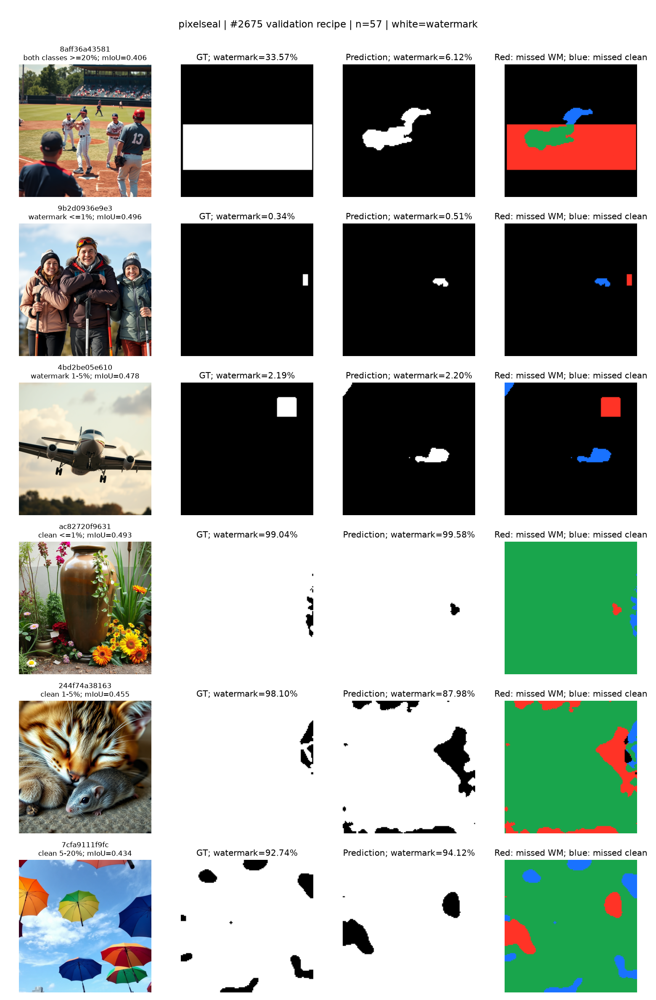
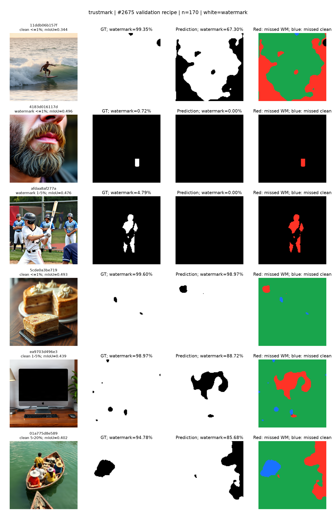
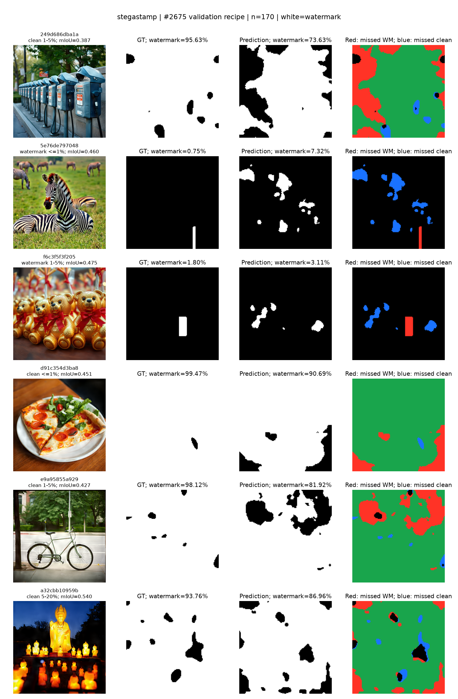

# Audyt błędów najlepszego zgłoszenia i jedna rekomendacja

> Historical snapshot: this report describes the named earlier submission. The latest recorded best is #3054 (public mIoU 0.6677); see the [documentation index](../DOCUMENTATION_INDEX.md).

Stan 2026-11-22. Najlepszy zapisany zaakceptowany wynik: **#2675, public mIoU 0,6440**. Potwierdzenie: [server_receipt.json](../local_presence/results/submission/server_receipt.json). Nie wykonywano nowego treningu, inferencji modeli ani zgłoszenia. Przeliczono istniejące predykcje i sprawdzono źródła metod.

## Zakres i pochodzenie

Przeanalizowano **397 obrazów walidacyjnych**, sprawdzając identyczność zapisanych masek GT z oficjalnym `data/train/masks_128.npz` i unikalność nazw. Ponownie policzono oficjalne mIoU, IoU obu klas, recall, całkowite pominięcia, pokrycie predykcji, geometrię klasy mniejszościowej i udział grup w błędzie. Obejrzano 18 deterministycznie wybranych przykładów: najgorszy ogółem oraz najgorsze z pięciu grup błędów dla każdej metody. To nie wizualny przegląd wszystkich 397 zdjęć.

| Metoda | Dostępne obrazy | mIoU | Co dokładnie reprezentują |
|---|---:|---:|---|
| PixelSeal | 57 | 0,570883 | Jeden odłożony fold receptury wybranej do #2675; model trenowany na pozostałych 113 obrazach |
| TrustMark | 170 | 0,657046 | Istniejące OOF z korektą NRGMark i zamrożonym skanem pustych masek |
| StegaStamp | 170 | 0,694962 | Niezmieniony model synthetic-only oceniony na rzeczywistych danych |

Wysłany PS był refitowany na wszystkich 170 obrazach. Ocenianie jego dopasowania na tych samych obrazach nie byłoby walidacją; dlatego wykorzystano odłożony fold. Test nie udostępnia GT. Powyższe protokoły są różne i wielokrotnie używane rozwojowo — nie łączymy ich w bezstronny wynik CV ani nie przypisujemy pojedynczym testowym obrazom błędów.

Źródła i SHA-256: [provenance.json](results/provenance.json). Wszystkie obrazy i wyniki: [per_image.csv](results/per_image.csv), [per_image.json](results/per_image.json). Agregaty i 10 najgorszych obrazów każdej metody: [summary.json](results/summary.json).

## Gdzie rzeczywiście jest problem

W tabeli wynik oznacza IoU wskazanej małej klasy; pominięcia oznaczają zerowe przecięcie predykcji z tą klasą. Mianownik to liczba obrazów danej grupy, nie liczba komponentów.

| Grupa | PixelSeal: IoU; pominięcia | TrustMark: IoU; pominięcia | StegaStamp: IoU; pominięcia |
|---|---|---|---|
| Watermark ≤1% | 0,0000; 7/7 | 0,2454; 6/9 | 0,1898; 7/12 |
| Watermark 1–5% | 0,0127; 8/9 | 0,5040; 10/36 | 0,3601; 8/33 |
| Czysty fragment ≤1% | 0,0000; 4/4 | 0,0057; 11/14 | 0,1499; 3/12 |
| Czysty fragment 1–5% | 0,0755; 6/10 | 0,1478; 12/25 | 0,3134; 0/23 |
| Czysty fragment 5–20% | 0,3116; 1/8 | 0,3387; 1/36 | 0,5477; 0/43 |

Watermark ≤5% i clean ≤5% to rozłączne grupy. Łącznie odpowiadają za **60,98% błędu PS, 53,03% TM i 57,53% SS** w ich własnych walidacjach. Błąd oznacza sumę `1−mIoU`; te udziały nie są prognozą odzyskiwalnego wyniku.

W TM obrazy z czystą klasą ≤20% odpowiadają za **54,67% całego błędu**. Dalsze szukanie samych dodatnich prostokątów omija więc większość obecnego problemu tej rodziny. Jednocześnie błąd nie dotyczy wyłącznie rozmiaru: największa pojedyncza strata PS występuje na prostokącie watermarka zajmującym 33,57% obrazu.

## Konkretne obrazy i objawy

| Obraz | Treść widoczna na zdjęciu | GT i predykcja | Wniosek z obrazu |
|---|---|---|---|
| PS `4bd2be05e610` | Samolot na tle nieba | Watermark 2,19%, predykcja 2,20%, FG IoU **0** | Powierzchnia jest prawie poprawna, lecz region leży całkiem gdzie indziej: GT na niebie, predykcja częściowo przy samolocie i rogu kadru. Sam prior powierzchni nie wystarczy. |
| PS `9b2d0936e9e3` | Trzy osoby w górach | Watermark 0,34%, predykcja 0,51%, FG IoU **0** | Mały prostokąt przy prawej krawędzi pominięty, fałszywy region bliżej środka. |
| PS `8aff36a43581` | Baseball | Watermark 33,57%, predykcja 6,12%, mIoU **0,4061** | Model odnajduje tylko część dużego prostokąta. Problem spójności zasięgu, nie tylko małych obiektów. |
| PS `7cfa9111f9fc` | Kolorowe parasole na niebie | Clean 7,26%, przewidywane clean 5,88%, clean IoU **0** | Całkowicie błędne położenie czystych fragmentów mimo podobnego łącznego pola; osiem komponentów GT. |
| TM `afdaa8af277a` | Baseballista | Watermark 4,79%, predykcja pusta | Nieregularna pozostałość, siedem komponentów; sam prostokąt dekodowany pełną wiadomością nie opisuje problemu. |
| TM `11ddb06b157f` | Surfer na fali | Clean 0,65%, przewidywane clean 32,70%, mIoU **0,3443** | Oprócz słabej lokalizacji małego clean model wycina ogromny fałszywy obszar. |
| SS `249d686dba1a` | Rząd parkometrów | Clean 4,37%, przewidywane clean 26,37%, mIoU **0,3875** | Duże fałszywe czyste obszary, utrata prawidłowego watermarka. |
| SS `5e76de797048` | Zebry | Watermark 0,75%, predykcja 7,32%, FG IoU **0** | Cienki prostokąt przy dolnej krawędzi pominięty; fałszywe wyspy w innych miejscach. |

Treść zdjęć jest opisem wizualnym, nie etykietą mechanizmu edycji. Nie ma podstaw, aby uznać np. wszystkie zdjęcia nieba albo ludzi za osobną wadliwą klasę semantyczną. Powtarzają się trzy objawy: brak detekcji, błędne położenie i zły zasięg/kształt.

Białe piksele oznaczają watermark. Czerwony to pominięty watermark, niebieski to pominięty clean (fałszywy watermark), zielony to poprawny watermark. Czarne piksele na mapie błędów to poprawny clean.

## Co mówią najnowsze eksperymenty

Dokument REPORT TriForensic zawierał tylko wczesne kroki; aktualniejsze są zapisane [completed.json](../triforensic_wm/results/pixelseal/unified-v1/completed.json) i [comparison-2675.json](../triforensic_wm/results/pixelseal/unified-v1/comparison-2675.json). Kandydat po 1561 krokach osiąga **0,581635** na tych samych 57 obrazach PS wobec **0,570883** receptury #2675. Nie znaleziono potwierdzenia jego zgłoszenia; najlepszy zapisany publiczny wynik nadal wynosi 0,6440.

Jednak kandydat nadal ma FG IoU **0** na wszystkich 7 obrazach ≤1% i wszystkich 9 obrazach 1–5%, a clean IoU **0** na wszystkich 4 obrazach clean ≤1%. Jego lepszy wynik ogólny nie oznacza naprawy wskazanego problemu.

Lokalna gałąź kandydata ma dla tiny PS AUC **0,8120**, ale AP tylko **0,0850** i IoU **0,0547**. Jej samodzielne globalne mIoU wynosi **0,3085**. Jest pewien sygnał rankingowy, lecz zbyt wiele fałszywych wskazań, aby zastosować ją bezpośrednio.

W audycie fuzji z kroku **1000** poprawka wynosiła około **+0,009** przy logitach bazowych około **−5,3** w małych watermarkach. To lokalna diagnoza zapisanej fuzji, nie dowód, że samo zwiększenie współczynnika rozwiąże problem. Większa waga zaszumionej mapy może powtórzyć wcześniejsze regresje.

## Jedna rekomendowana metoda

**Niezależny korektor regionów typu Mask R-CNN: propozycja regionu → klasa watermark/clean → własna maska → ocena jakości i decyzja o zastosowaniu.**

To najlepiej uzasadniony następny eksperyment, nie potwierdzona najlepsza metoda. Regiony są przewidywane z obrazu i cech modelu, nigdy z GT ocenianego obrazu.

- Wykorzystać istniejące lokalne cechy watermarka i cechy kontekstu. Propozycje obejmują małe i cienkie regiony oraz brzegi, z zachowaniem wysokiej rozdzielczości cech. Nie powiększać surowych pikseli w przekonaniu, że odtworzy to utracony sygnał.
- Dla każdej propozycji przewidywać niezależną maskę oraz klasę `watermark`, `clean` lub `brak korekty`. Mała klasa otrzymuje nadzór na poziomie regionu; nie jest tylko drobną poprawką do bardzo pewnego logitu bazowego.
- Uczyć obie polaryzacje na niezmienionych oficjalnych embedderach, dokładnych syntetykach i dozwolonych maskach treningowych. Prostokąty, nieregularne pozostałości oraz clean overwrites muszą mieć osobne raportowanie. Czyste pary, niskie JND i naturalne tekstury są trudnymi negatywami.
- Głowica maski zachowuje nieregularne kształty; nie wypełnia automatycznie całego bbox. Oceniać też jakość/korzyść korekty, aby odrzucać duże fałszywe wycięcia widoczne np. na surferze. Poza zaakceptowanym regionem zachować bazę; konflikty propozycji rozstrzygać oceną jakości lub abstencją.
- Dla PS nie wymagać pełnego odczytu wiadomości: wcześniejsze dekodowanie idealnych GT-bbox nie uzasadnia takiej bramki. Sprawdzony verifier TM pozostawić jako dodatkowe źródło informacji w jego dotychczasowym zakresie.

Uzasadnienie pierwotnymi źródłami: [NRGMark](https://collomosse.com/pubs/Agarwal-WACV-2026.pdf) pokazuje uczenie oddzielnego lokalizatora przy stałym watermark encoderze/dekoderze; [Mask R-CNN](https://arxiv.org/abs/1703.06870) uzasadnia osobne maski regionalne; [Mask Scoring R-CNN](https://arxiv.org/abs/1903.00241) rozdziela pewność klasyfikacji od jakości maski. Żadna z tych prac nie dowodzi sukcesu na naszym tiny PixelSeal. NRGMark ma znacznie większe regiony i nie testuje PS. Ocena korzyści względem bazowej maski oraz obie polaryzacje są proponowaną adaptacją, a nie gotowym wynikiem z publikacji.

## Jak rozstrzygnąć, czy metoda działa

Pierwszy screen: PS na tym samym podziale 113/57. Porównywać zarówno z #2675 **0,570883**, jak i nowszym kandydatem **0,581635**. Przy uczeniu oceny korzyści generować bazowe predykcje dla treningu przez wewnętrzny cross-fit; progi ustalać wyłącznie na wewnętrznym train/dev, nie na tych 57 obrazach.

Z góry przyjąć kryterium kontynuacji: co najmniej **+0,01 mIoU względem 0,581635**, odzyskanie co najmniej **2/7** tiny watermarków przy FG IoU ≥0,25 i brak spadku średniej jakości na obrazach z watermarkiem >5%. Raportować także małe clean, liczbę błędnie zaakceptowanych korekt, recall propozycji i zmiany per obraz. To kryterium inżynierskie dla krótkiego screeningu, nie gwarancja istotności statystycznej.

Gdy propozycje nie trafiają w regiony, problem pozostaje w reprezentacji/detekcji. Gdy propozycje trafiają, lecz maski lub akceptacja są błędne, dalsza praca dotyczy segmentacji regionalnej lub kalibracji. Nie kontynuować długiego treningu tylko na podstawie poprawy AUC. Po udanym screenie potrzeba osobnego sprawdzenia na pozostałych foldach przed deklarowaniem generalizacji. Nie obiecujemy czasu ani wyniku publicznego bez pomiaru.

Pełniejsze uzasadnienie metody i źródła: [METHOD_RESEARCH.md](METHOD_RESEARCH.md). Reprodukcja audytu CPU: `task-1/.venv/bin/python task-1/experiments/best_model_error_audit/analyze.py`.
