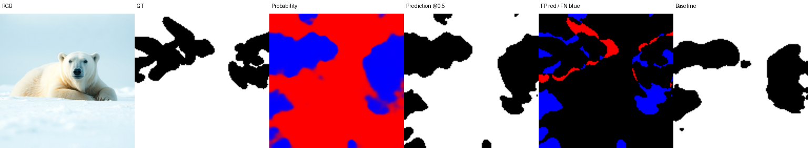
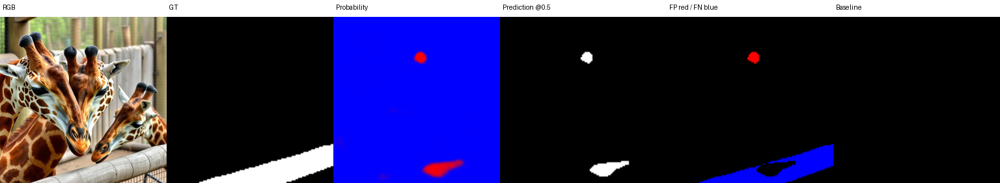
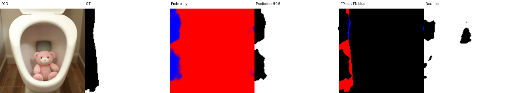
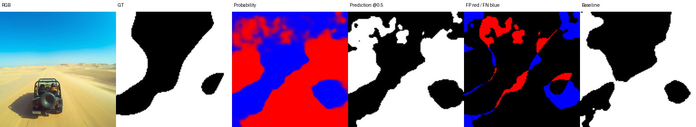
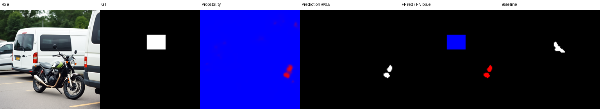
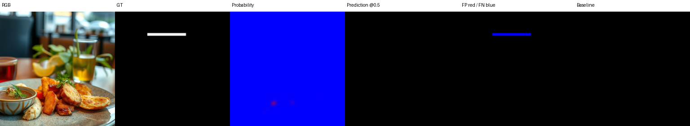
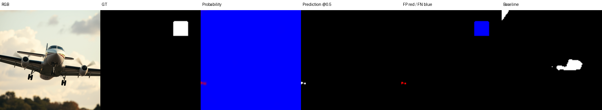
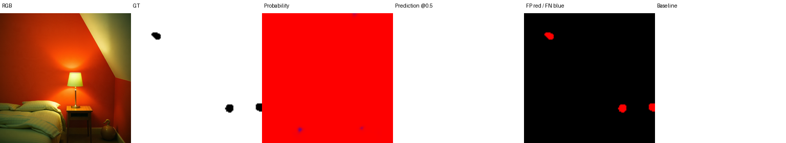

# PixelSeal validation gallery

All examples belong to the same57-image development fold. Selection intentionally includes gains, regressions, tiny watermark failures and clean holes; it is not a random sample.

## 07c5ceca91f8

mIoU 0.6020 → 0.6784; FG IoU 0.7755 → 0.8102; clean IoU 0.4285 → 0.5467; true watermark area 77.45%.

## bab81c5c46bc

mIoU 0.4591 → 0.5361; FG IoU 0.0000 → 0.1459; clean IoU 0.9183 → 0.9262; true watermark area 8.17%.

## ebfc9dc16dd6

mIoU 0.5312 → 0.7747; FG IoU 0.8776 → 0.9444; clean IoU 0.1847 → 0.6051; true watermark area 87.47%.

## 0b2fb5e65207

mIoU 0.7630 → 0.6631; FG IoU 0.8061 → 0.7073; clean IoU 0.7199 → 0.6189; true watermark area 59.62%.

## 435a049a735c

mIoU 0.5440 → 0.4837; FG IoU 0.1145 → 0.0000; clean IoU 0.9735 → 0.9673; true watermark area 2.78%.

## 330fb70f8303

mIoU 0.4961 → 0.4961; FG IoU 0.0000 → 0.0000; clean IoU 0.9921 → 0.9921; true watermark area 0.79%.

## 4bd2be05e610

mIoU 0.4781 → 0.4887; FG IoU 0.0000 → 0.0000; clean IoU 0.9561 → 0.9775; true watermark area 2.19%.

## e7ece8e6125a

mIoU 0.4957 → 0.4957; FG IoU 0.9914 → 0.9914; clean IoU 0.0000 → 0.0000; true watermark area 99.14%.

