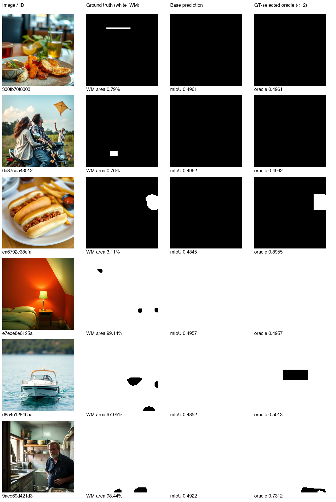

# PCMV: walidacja bez treningu na RTX 3070

Data: 2026-11-22. **Treningi poprzedniego eksperymentu zatrzymane. Nie wytrenowano PCMV i nie wysłano predykcji na leaderboard.**

**Werdykt: jest sygnał uzasadniający dalszą walidację ablacji dla czystych dziur w PixelSeal. Nie ma jeszcze potwierdzonej poprawy masek ani podstaw do przewidywania 0,80 mIoU. Pełny PCMV nie przeszedł etapu 0: zbadany podzbiór propozycji ma za słabe pokrycie, a małe dodatnie regiony nie dają mocnego sygnału.** Nie jest to odrzucenie nieprzetestowanych propozycji forensic ani całej architektury.

## Co rzeczywiście wykonano

1. Przegląd źródeł, implementacji i matematyki: [RESEARCH.md](RESEARCH.md).
2. Ponowna analiza zapisanych sond zamrożonych dekoderów dla wszystkich trzech rodzin.
3. Nowy test pokrycia propozycji na stałym, walidacyjnym foldzie 57 obrazów PixelSeal, z dokładnym oracle maksymalnie dwóch rozłącznych zmian.
4. Nowy test sygnału zamrożonego PixelSeal na 43 małych watermarkach i 38 małych czystych dziurach; 2 dziury wykluczone z powodu braku dopasowanych kontroli. Użyto prawdziwego kształtu regionu (GT), więc jest to diagnostyka oracle, nie skuteczność automatycznego weryfikatora.

Nie wykonano treningu selektora, pełnego 3-fold OOF, nowych pomiarów publicznych, testów 200 clean/full-WM twins ani pełnej kontroli B. Nie użyto niedostępnych tutaj map lokalnego TriForensic. Raport rozdziela te braki od pomiarów zakończonych.

## 1. Pokrycie propozycji: problem występuje przed klasyfikacją

Baza to dokładnie `local_presence/results/ps-data-small/maps-150.npz`: PS z #2675, niezmieniony w #3005 i #3054. Wynik bazowy odtworzono: **0,570883**. To jeden fold 57 obrazów, nie 170-image OOF ani public leaderboard.

Generator: istniejące, zamrożone SAM2.1 Hiera Base Plus; siatka 16×16, bez dodatkowych crop layers; kwoty 40 SAM / 20 prostokątów / 20 komponentów bazy przed deduplikacją, maksymalnie 80. Po deduplikacji: 30–53, średnio 43,91 propozycji na obraz. Propozycje i ich limit wybierano bez GT. **Brakuje** forensic-prompted SAM, watershed, NRGMark i pełnego wieloskalowego zestawu z propozycji użytkownika.

GT służy wyłącznie ocenie i wyborowi najlepszej zmiany. Kompozycja na oficjalnej siatce 128×128, po majority downsampling propozycji 512. Dokładna enumeracja par uwzględnia wspólną zmianę macierzy pomyłek; nie sumuje zmian IoU.

| Podzbiór | N | Baza mIoU | Oracle ≤1 zmiana | Oracle ≤2 zmiany | Obrazy z propozycją IoU ≥0,5 względem mniejszości |
|---|---:|---:|---:|---:|---:|
| Wszystkie | 57 | 0,5709 | 0,6628 | 0,6788 | 19/57 |
| Watermark ≤1% | 7 | 0,4967 | 0,5211 | 0,5211 | 0/7 |
| Watermark 1–5% | 9 | 0,4947 | 0,6298 | 0,6402 | 2/9 |
| Czysta dziura ≤1% | 4 | 0,4955 | 0,5444 | 0,5633 | 0/4 |
| Czysta dziura 1–5% | 10 | 0,5172 | 0,5757 | 0,5896 | 1/10 |

Oracle zyskuje **+0,107918**, poniżej proponowanego progu **+0,15 dla PS**. To osiągalność z pomocą prawdziwej maski, a nie poprawa działającego modelu. Nie oznacza też maksymalnego wyniku po rozbudowaniu generatora.

Konkretne przypadki w galerii:

- `330fb70f8303`: bardzo cienki prostokąt nad napojem, 0,79% obrazu; oracle nie poprawia pustej maski.
- `6a87cd543012`: mały prostokąt na dole obrazu motocykla, 0,76%; również bez poprawy.
- `ea6792c38efa`: nieregularny fragment przy prawej krawędzi, 3,11%; dobre pokrycie umożliwia oracle 0,8955 zamiast 0,4845.
- `e7ece8e6125a`: kilka drobnych czystych dziur, łącznie 0,86%; oracle pozostaje 0,4957. Mniejszość nie musi być jednym obiektem.
- `d854e128465a`: kilka dziur w obrazie łodzi, 2,95%; proponowane kształty słabo pasują, oracle tylko 0,5013.
- `9aec69d421d3`: dziury przy dolnej krawędzi kuchni, 1,56%; oracle częściowo pomaga: 0,4922 → 0,7312.

Pełny podział IoU₀/IoU₁, complete misses, czterech przedziałów pola mniejszości osobno dla wysp i dziur oraz prostokątnych/nieregularnych masek: [mask_metrics.json](results/mask_metrics.json). Bootstrap dotyczy wyłącznie oracle z GT, nie poprawy wdrażalnego modelu.

Pełne wyniki per obraz, pochodzenie i hashe: [proposal_screen.json](results/proposal_screen.json).

## 2. Nowy sygnał: obiecująca ablacja czystych dziur

Zamrożony PixelSeal otrzymał dwie jawnie rozdzielone wersje wejścia: **256 zgodnie z oryginalnym wrapperem** oraz **512 z pominięciem jego resize**. Wersja 512 jest testem zmiany rozkładu wejścia; samo maskowanie obrazu w miejscu nie zapewnia skali 1:1 we wrapperze.

Bias bitów oszacowano na 200 czystych syntetycznych coverach ze zbioru TRAIN, osobno dla każdej rozdzielczości. Nie optymalizowano parametrów dekodera. Dla prawdziwego kształtu regionu dobrano do pięciu translacji tego samego kształtu i pola w tym samym obrazie: najwyżej 1% nakładania na mniejszość i średnie JND różniące się najwyżej o 50%. Kontrole wybrano bez wyników dekodera, ale z pomocą GT. Jest to dość szerokie dopasowanie tekstury, nie pełne usunięcie confoundingu.

**AUC rankingu** poniżej oznacza średnią po obrazach częstość poprawnej kolejności prawdziwego regionu względem jego kontroli. To nie ROC-AUC na automatycznie znalezionych propozycjach ani mIoU. Dla dziur kierunek sygnału jest odwrócony. CI: 5000 bootstrapów po obrazach; null: 256 losowych błędnych wiadomości. Regiony, kontrole i logity są stałe podczas podmiany wiadomości.

| Podzbiór / sonda | N | AUC rankingu | 95% CI | Średnia po błędnych wiadomościach |
|---|---:|---:|---:|---:|
| Czyste dziury ≤5%, ablacja 512 bez normalizacji | 36 | **0,8222** | **0,7222–0,9111** | **0,4964** |
| Czyste dziury ≤5%, ablacja 512 / JND | 36 | 0,8222 | 0,7222–0,9111 | 0,4963 |
| Czyste dziury ≤5%, ablacja 256 bez normalizacji | 36 | 0,6889 | 0,5778–0,8000 | 0,5034 |
| Czyste dziury ≤5%, ablacja 256 / JND | 36 | 0,7000 | 0,5889–0,8056 | 0,5037 |
| Czyste dziury ≤5%, masked pooling 512 | 36 | 0,7611 | 0,6611–0,8556 | 0,5003 |
| Małe watermarki ≤5%, najlepsza sonda: isolation z 512 | 43 | **0,5953** | **0,4930–0,6977** | **0,5057** |

Dla dziur empiryczne p po maksymalizacji po 12 sondach wynosi **1/257 = 0,00389**; dla małych watermarków **0,358**. Przedziały CI dotyczą poszczególnych sond i nie są skorygowane za wybór najlepszej. Ta korekta 12 sond nie zastępuje kalibracji wyszukiwania najlepszej propozycji z 80 na obrazie.

W dodatkowym, opisowym podziale: ablacja 512 na dziurach ≤1% daje **0,6667 (12 obrazów)**. Wszystkie 36 zbadanych dziur są nieregularne według proxy wypełnienia bbox <98%. Wśród małych watermarków isolation 512 daje 0,5706 na 34 prostokątnych oraz 0,6889 na 9 nieregularnych regionach. Są to małe podgrupy, nie osobno potwierdzone efekty.

**Normalizacja JND nie podniosła średniego rankingu ablacji 512.** Korzyść obecnie pochodzi z odpowiedzi na ablację, nie z udowodnionej przewagi całego mechanizmu PCMV. Nie zbadano jeszcze kontrastu JND-stratified lokalnego TriForensic.

Równie ważne: w **30/36 czystych dziur** rzeczywisty spadek marginesu po ablacji był dodatni; w **22/43 watermarked regions** był ujemny. Reguła „znak spadku dowodzi obecności watermarka” jest więc fałszywa w tych danych. Użyteczny może być **ranking względem kontroli w tym samym obrazie**, nie sam znak. Neutralne wypełnienie zmienia treść i kontekst dekodera.

Źródła: [signal_oracle.json](results/signal_oracle.json), [podgrupy](results/signal_subgroups.json). Ten eksperyment użył wszystkich dostępnych małych przypadków PS, także poza stałym foldem 57; nie jest jego niezależnym potwierdzeniem OOF. Dobór kierunku dalszych badań na tych wynikach wymaga późniejszej odseparowanej oceny.

## 3. Pozostałe warunki wymagające korekty

- Nie ma kompletnego, obecnego „#3005 OOF dla 510 obrazów”. PS ma nowszy stały fold 57; pełne wcześniejsze OOF dotyczy innego przepisu. Lokalny TriForensic także nie dostarcza gotowych 3-fold map dla trzech rodzin. Stacking wymaga poprawnego wewnętrznego cross-fitting, by modele wytwarzające cechy treningowe nie widziały etykiet aktualnego outer foldu.
- `z = dot(tanh(logits-bias), message_signs) / norm(...)` ma wariancję 1 przy niezależnych, równoprawdopodobnych losowych znakach wiadomości. Nie jest automatycznie testem Gaussa ani poprawnie standaryzowaną permutacją wiadomości o stałej liczbie jedynek. Należy kalibrować maksimum całego wyszukiwania. Przykładowo 148/256 trafień daje p≈0,00731; przy 80 niezależnych próbach szansa co najmniej jednego takiego trafienia wynosi 44,4% (ilustracja, rzeczywiste propozycje są skorelowane).
- Dwie rozłączne, osobno korzystne zmiany mogą razem obniżyć mIoU. Wykonany kontrprzykład: 0,28958 → 0,30556 dla każdej osobno, ale 0,275 dla obu. Selekcja musi uwzględniać stan po pierwszej zmianie lub wynik pary.
- JND jest miarą percepcyjną, nie wykazaną mocą statystyczną testu. Masked GAP nie usuwa kontekstu, który już wszedł przez receptive field i globalną normalizację.
- Zamiana wiadomości powinna usuwać korzyść przypisywaną sondzie wiadomości, nie koniecznie korzyść geometrii. Testy twins powinny liczyć szkodliwe zmiany względem bazy, nie wszystkie zmiany.

Rozwinięcie i pierwotne źródła: [RESEARCH.md](RESEARCH.md). Starsze zapisane sondy PS/TM/SS potwierdzają, że pełny canvas z neutralnym tłem był słaby także przy ciągłym wyniku, a nie tylko przy progu 90%: [reanaliza](results/cached_oracle_reanalysis.json). Nie należy mieszać ich wcześniejszej funkcji soft-score z nową kalibracją biasu.

## 4. RTX 3070, weryfikacja i decyzja

Nowe obliczenia zakończone na **RTX 3070 8 GB**: generator i oracle 57 obrazów **36,27 s**, szczyt pamięci przydzielonej przez PyTorch **0,954 GB**; sondy sygnału **43,55 s**, **1,112 GB**. To zmierzony czas tych konkretnych skryptów, po przygotowaniu lokalnych danych i wag; nie obejmuje całego przeglądu, transferów ani wdrożenia. Nie ekstrapolujemy z niego 10–18 GPU-godzin pełnego PCMV. GTX 1080 Ti nie był używany do tych testów.

Sprawdzono zgodność full-mask spatial pooling z oryginalnym dekoderem: maksymalny błąd **2,12e-6**. Dokładny oracle dwóch zmian porównano z brute-force w 50 losowych przypadkach; zgodność do 1e-12. Odtworzono bazowe mIoU i kontrprzykład nieaddytywności. [checks.json](results/checks.json).

**Jedna rekomendowana metoda do dalszego sprawdzenia:** weryfikator wyłącznie czystych dziur oparty na **kontraście ablacji zamrożonego PixelSeal przy wejściu 512 względem dopasowanych kontroli**, początkowo z co najwyżej jednym carve. Najpierw potrzebuje propozycji bez GT obejmujących rzeczywiste dziury oraz pomiaru fałszywych wycięć na clean/full-WM twins i przy błędnych wiadomościach. Dopiero po spełnieniu tych warunków uzasadniony będzie trening selektora. Obecny test nie uzasadnia uruchomienia pełnego PCMV ani podania prognozy publicznego wyniku 0,80.

Poprzedni eksperyment wszystkich informacji został zakończony jako **brak wykazanej poprawy**: PS Δ−0,00399, TM Δ−0,00375, oba CI obejmują zero; SS nie wytrenowano. [Raport zatrzymanego eksperymentu](../rtx_all_information/REPORT.md). Najlepszy istniejący publiczny wynik pozostaje **#3054: 0,6677**; badania PCMV go nie zmieniły.

Skrypty odtwarzające obliczenia: `validate_cached.py`, `proposal_screen.py`, `signal_oracle.py`. Wagi i duże cache pozostają lokalnie na maszynie RTX; żaden skrypt nie uruchamia treningu.
