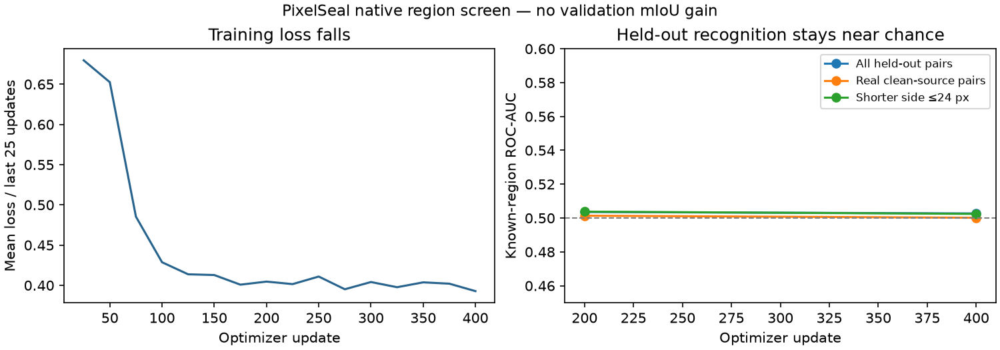

# PixelSeal: native whole-region presence screen

This experiment keeps submission #3188 (public mIoU0.6736) as its baseline. Known-geometry recognition and search coverage are diagnostics; only GT-free masks count toward validation mIoU. One repeatedly inspected57-image development fold, not full OOF.

[Predeclared protocol](PROTOCOL.md). Exact original embedder and quantization; fresh trainable region representation; no90%-payload gate. Real clean-source generation and new model fitting exclude the outer validation fold.

## Geometric coverage only

The predefined search contains 500,494 candidates per512 image before local refinement. GT is used only to score this coverage, never to choose candidates at inference.

| Group | n | Candidates covering GT at IoU≥0.5 | Mean best IoU |
|---|---:|---:|---:|
| fg_le1 | 7 | 7 | 0.877567 |
| fg_1to5 | 9 | 9 | 0.841507 |

This removes the specific tiny-rectangle proposal coverage failure of PCMV. It does not establish that the trained model identifies the correct rectangle.

## Completed fixed-fold evaluation

One reused 57-image PixelSeal development fold; new classifier trained on90 real sources plus exact clean-region/public pairs;23 source-disjoint real inner calibration. Base EMA1561 saw all113 outer-training images; base-calibration optimism remains, specialist does not see23 calibration images. No full OOF.

Baseline 0.581724 → candidate **0.581724**, delta +0.000000; paired95% bootstrap [0.0, 0.0]. Applied corrections: 0/57. Threshold selected on inner calibration: 1.1. Candidate for test inference: False.

| Bucket | n | Metric | Baseline | Candidate | Complete misses before / after |
|---|---:|---|---:|---:|---|
| fg_le1 | 7 | fg_iou | 0.000000 | 0.000000 | 7 / 7 |
| fg_1to5 | 9 | fg_iou | 0.000000 | 0.000000 | 9 / 9 |
| fg_5to20 | 11 | fg_iou | 0.392297 | 0.392297 | 0 / 0 |
| fg_gt20 | 30 | fg_iou | 0.881543 | 0.881543 | 0 / 0 |
| clean_le1 | 4 | clean_iou | 0.000000 | 0.000000 | 4 / 4 |
| clean_1to5 | 10 | clean_iou | 0.106361 | 0.106361 | 5 / 5 |
| wm_over50 | 27 | clean_iou | 0.267867 | 0.267867 | 9 / 9 |

## Held-out recognition at known geometry

| Source/group | Pairs | ROC-AUC | Marked scores above exact clean twin |
|---|---:|---:|---:|
| all | 182 | 0.5027170631566236 | 0.23626373626373626 |
| real_clean | 54 | 0.5001714677640604 | 0.2037037037037037 |
| public | 128 | 0.503631591796875 | 0.25 |
| width_le24 | 67 | 0.5024504343951883 | 0.208955223880597 |

Known-box recognition uses privileged geometry and cannot be read as a deployable detection score. The search operates without GT. Regional source variants are clustered by original cover; paired accuracy is not independent pixel evidence.

## Matched precision audit

Frozen EMA400, same182 source-held-out pairs and known geometry, evaluated on NVIDIA GeForce RTX 3070. This is an inference diagnostic, not an FP32 retraining experiment.

| Arithmetic | ROC-AUC | Pair ties | Pair ordering (ties count half) |
|---|---:|---:|---:|
| fp32 | 0.501600 | 0.000% | 0.483516 |
| bf16 | 0.501298 | 57.143% | 0.521978 |
| bf16_encoder_fp32_head | 0.501721 | 0.000% | 0.505495 |

BF16 coarsens the final readout, but full FP32 still gives near-chance recognition. This checkpoint has not learned useful held-out presence recognition. That does not prove PixelSeal is undetectable or rule out a longer, differently designed training run.

## Data and optimizer exposure

95,610 trainable parameters. Effective batch12:8 synthetic paired views and4 real training images. At400 updates this is4,800 views (3,200 paired views and1,600 real draws), not4,800 unique images. The generated bank contains556 training pairs from331 sources,118 calibration pairs from82 sources and64 audit pairs from64 sources. All90 real training images remain eligible for supervised training; only75 yield valid wholly clean embedding windows. Calibration has23 real sources;18 yield such windows. There are738 actual exact embedding calls and no post-embedding image resampling.

## Executed budget

Completed update 400; elapsed 1.40 minutes inside the process; 2 GPU workers. Job 15905399. Stop reason: recognition_gate_or_time_budget. Queue and local implementation time excluded.

Training stopped at the predeclared400-update recognition gate. No test inference or leaderboard submission was made because the selected pipeline applies zero corrections. Submission#3188 remains the best accepted artifact. The A100 job completed and released its node. The Windows fallback process produced no training updates; Windows RTX3070 was used only for the completed precision audit.

Executed cluster source is preserved with hashes in `results/execution_provenance.json` and `results/executed_source/`. Current entrypoints additionally support one GPU at the same effective batch and remove an unnecessary evaluator import; the trained recipe is unchanged.

Reproduction in an allocated two-GPU job: `sbatch experiments/pixelseal_regions/run.sh`. The script uses the original source paths and skips already generated pairs. Set the reservation to the permitted queue for the account. The checkpoint includes weights, optimizer and scheduler state; automatic resume is not implemented.

